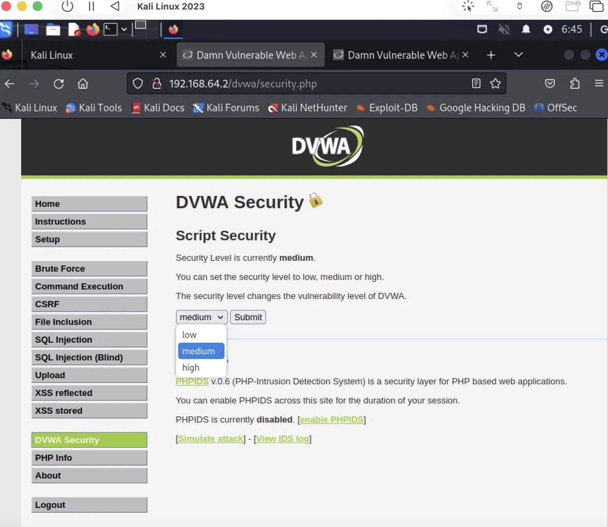

# Penetration Testing Portfolio

## Bug Bounty Lab — DVWA on Metasploitable2

I assessed Damn Vulnerable Web Application (DVWA) at its **Medium** security setting on a Metasploitable2 virtual machine. The lab ran on an isolated virtual network. The assessment documented account compromise, exposure of database information, and root-level access to the lab host.

### Assessment process

1. Used Nmap to inventory reachable services and identify software versions.
2. Assessed authentication, database-backed user lookup, and file upload controls in DVWA.
3. Evaluated how far a compromise could extend across application and host privilege boundaries.
4. Recorded observations in a penetration test report with supporting screenshots and tool output.

### Findings and remediation

| Finding | Observed impact | Recommended fix |
| --- | --- | --- |
| Weak login protections | Repeated password guesses compromised a standard user account. | Rate-limit login attempts, monitor authentication failures, and use multi-factor authentication where practical. |
| SQL injection in user lookup | User records, password hashes, and database metadata were exposed. | Use parameterized queries and restrict the application's database permissions. |
| Unsafe file uploads | An uploaded file executed with the web service account's privileges. | Validate file content, store uploads outside the web root, and disable execution in upload storage. |
| Vulnerable host service | Root-level access exposed system resources on the lab VM. | Patch or retire unsupported services, restrict network access to them, and review service privileges. |

### Scope and limitations

DVWA and Metasploitable2 are deliberately vulnerable training systems. The lab used a flat virtual network, so the assessment reflects the controls and exposure of that environment.

### Lab setup screenshot

